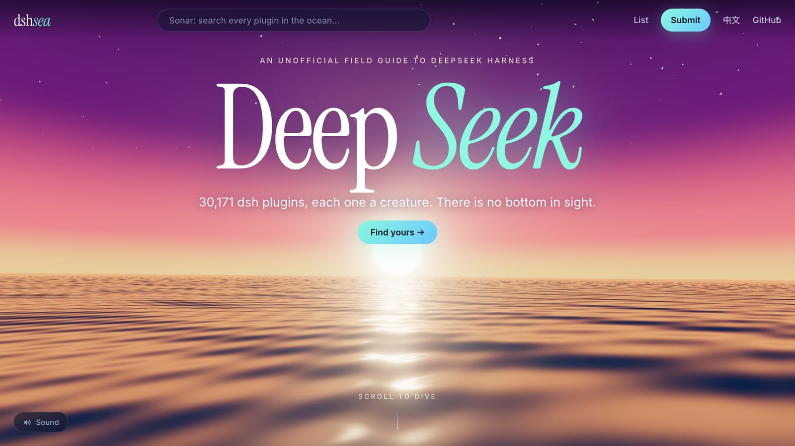
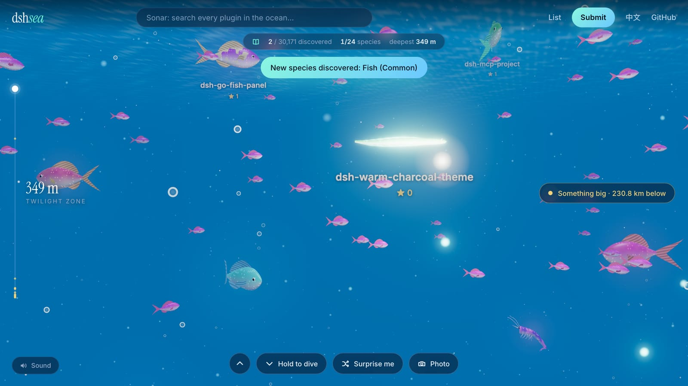
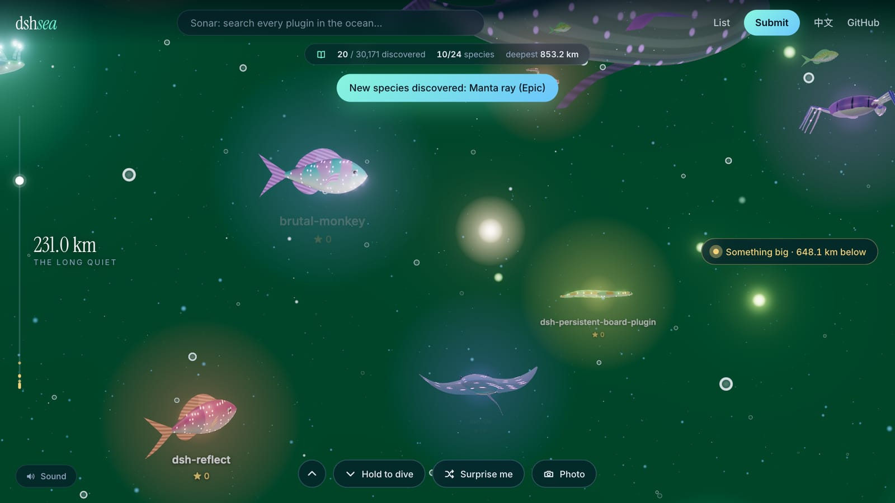
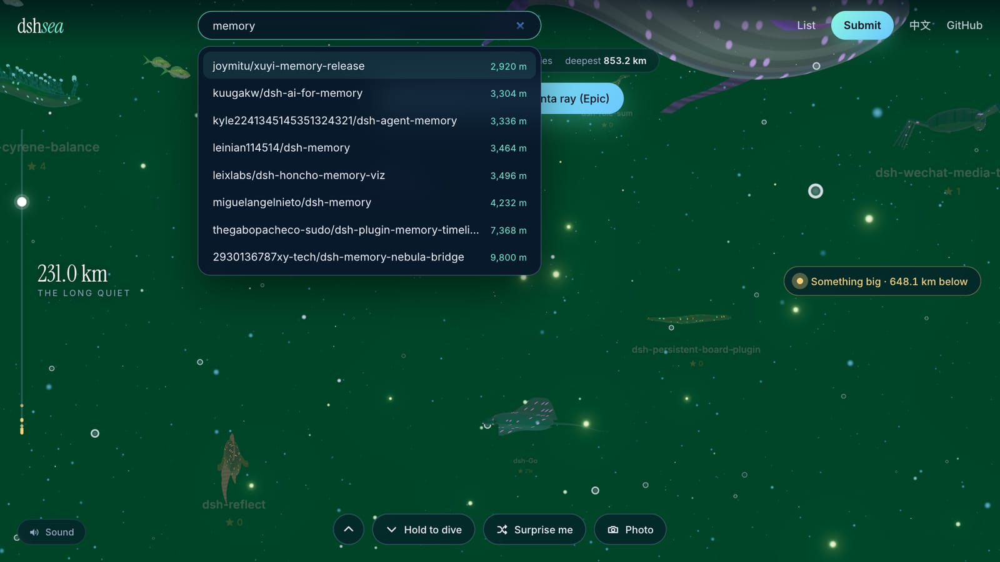
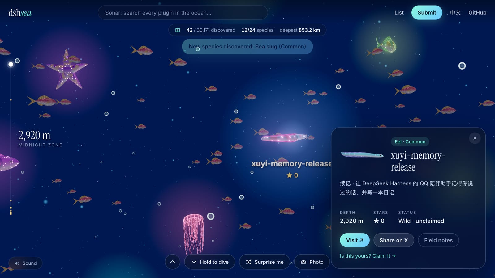
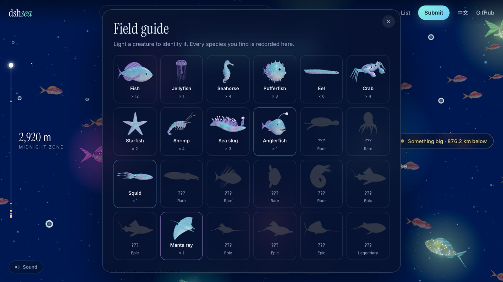
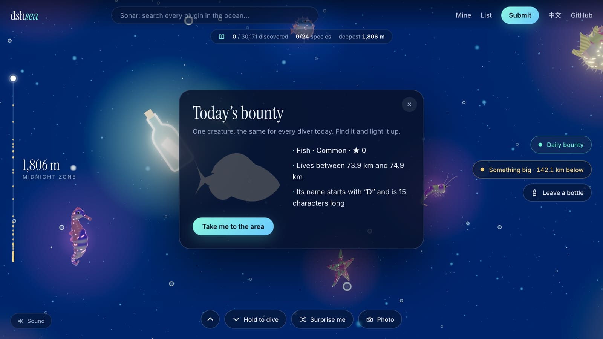
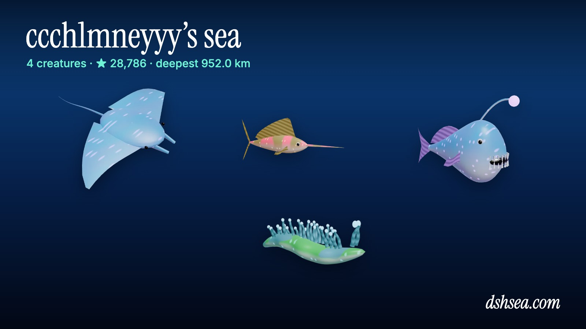
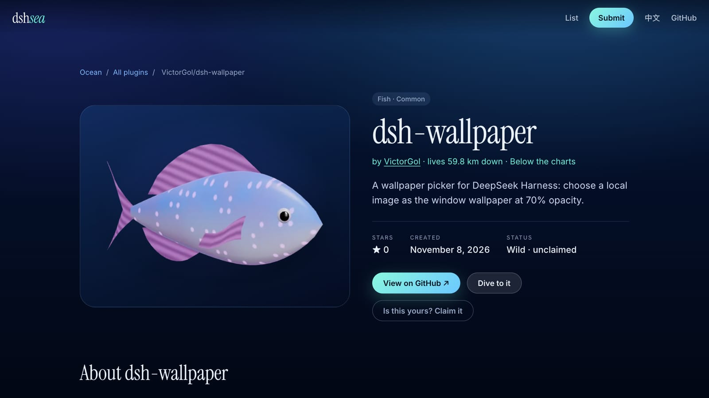

# dshsea

[English](README.md) · [简体中文](README.zh-CN.md) · **日本語** · [한국어](README.ko.md)

**[dshsea.com](https://dshsea.com)** — [DeepSeek Harness](https://github.com/deepseek-ai/deepseek-harness) の深海。

DeepSeek Harness のプラグインは、底なしの海のどこかにいる生き物です。3 万匹以上、24 種、同じ姿のものは一匹もいません。潜って、ライトで照らして正体を確かめ、図鑑を埋めて、自分の一匹を登録しましょう。

[](https://dshsea.com)

| | |
| --- | --- |
| [](https://dshsea.com) | [](https://dshsea.com) |
| **潜る。** スクロールやスワイプ、あるいはボタンを押し続けて何キロも落ちていきます。名前は、ライトかソナーが当たるまで隠れています。 | **底は見えない。** いちばん新しいプラグインは水深 260 m。古くなるごとに 32 m ずつ深くなり、水の色も変わっていきます。 |
| [](https://dshsea.com) | [](https://dshsea.com) |
| **ソナー。** すべてのプラグインを名前で検索して、その場所へ直行できます。 | **出会う。** どの生き物もリポジトリにリンクし、進化まであと何スター必要かを示します。作者は自分のものとして登録できます。 |
| [](https://dshsea.com) | [](https://dshsea.com) |
| **図鑑。** 24 種のコレクション、15 の実績、ランキング、そしていちばん近い大物を指し示すトラッカー。 | **デイリー賞金首。** 1 日 1 匹、全員が同じ標的。手がかりは 3 つ、範囲は 1 km。 |
| [](https://dshsea.com/u) | [](https://dshsea.com/r/victorgol/dsh-wallpaper) |
| **あなたの GitHub には何が棲んでいる？** `dshsea.com/u/<あなた>` に自分の生き物がすべて集まり、共有用のカードが作れます。 | **すべてのプラグインにページを。** `dsh-plugin` トピックのあるリポジトリには必ず `dshsea.com/r/owner/repo` があり、リポジトリへリンクしています。 |

ほかにも、**釣り**（欲しい機能に合わせて餌を選び、投げて、巻き上げると、インストールできるプラグインが 1 つ釣れます。各リポジトリのページには釣られた回数が表示されます）、**願いのボトル**（まだ存在しないプラグインを願い、ほかの人の願いに投票し、[いちばん望まれているもの](https://dshsea.com/wishes)を見られます）、そして**フォトモード**（`P` キー）があります。

## dsh の中で釣る

この海は dsh プラグインとしても使えます。欲しいものをエージェントに伝えると、インストールできるプラグインをいくつか釣り上げ、インストールコマンドも示します。[plugin/](plugin/) を参照。

```sh
dsh plugin --profile tui add "github:dshsea/dshsea#path:/plugin"
```

## 生き物の集まり方

- **野生の生き物。** 週 1 回の GitHub Action が `dsh-plugin` トピックのリポジトリをすべて `data/wild.json` に取り込み、自動的に海に現れます。
- **登録済みの生き物。** 作者が [`data/projects/`](data/projects) に YAML ファイルを 1 つ追加して PR を送ると登録できます。専用ページ、共有カード、バッジが付き、種も選べます。さらに、直近に登録された 8 匹は**ウェルカムリーフ**（全員が潜り始める水面直下）を泳ぎ、トップページにも名前が載ります。詳しくは [CONTRIBUTING.md](CONTRIBUTING.md) を参照してください。

## 参加する

登録方法、ファイル形式、掲載ルールは [CONTRIBUTING.md](CONTRIBUTING.md) にあります。ローカルでの実行とデプロイは [docs/DEVELOPMENT.md](docs/DEVELOPMENT.md)（英語）を参照してください。
