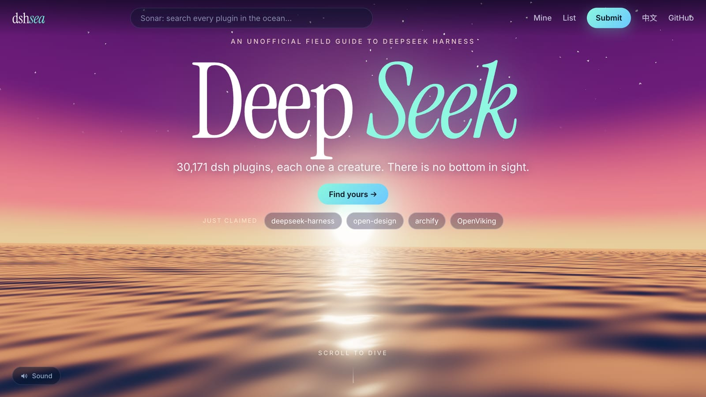
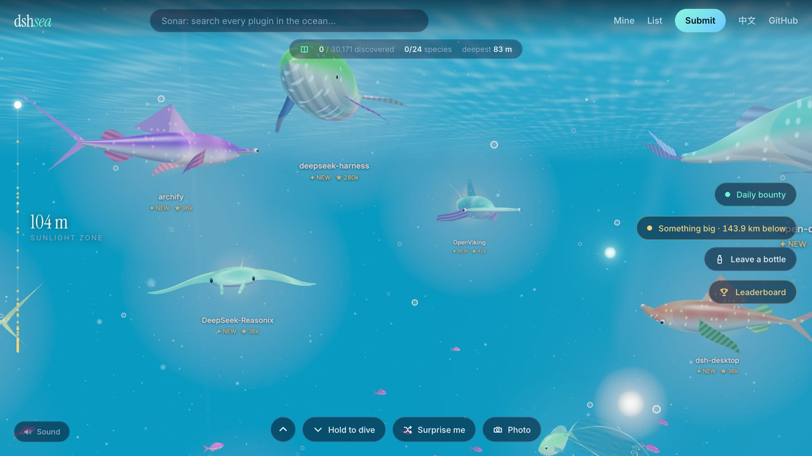
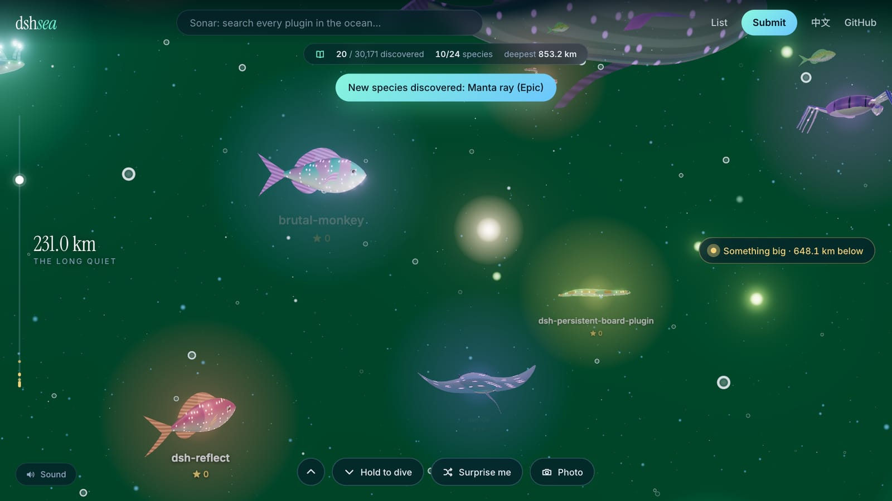
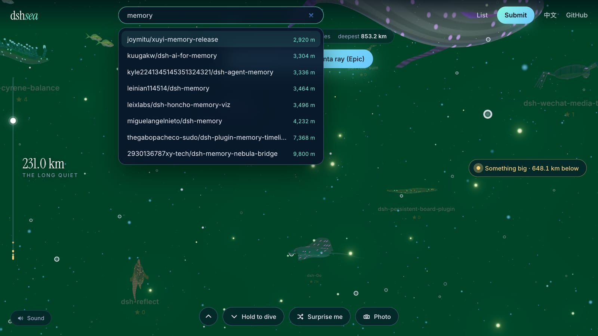
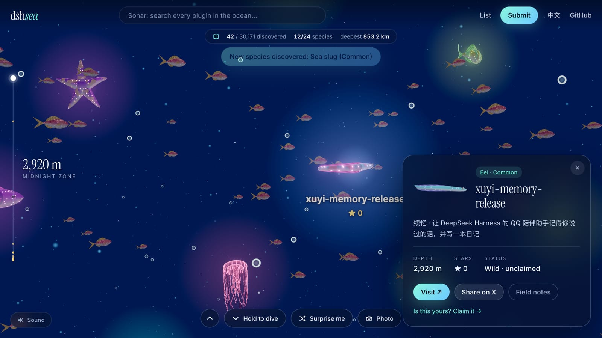
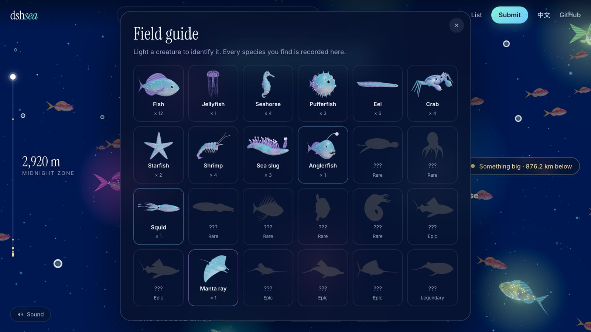
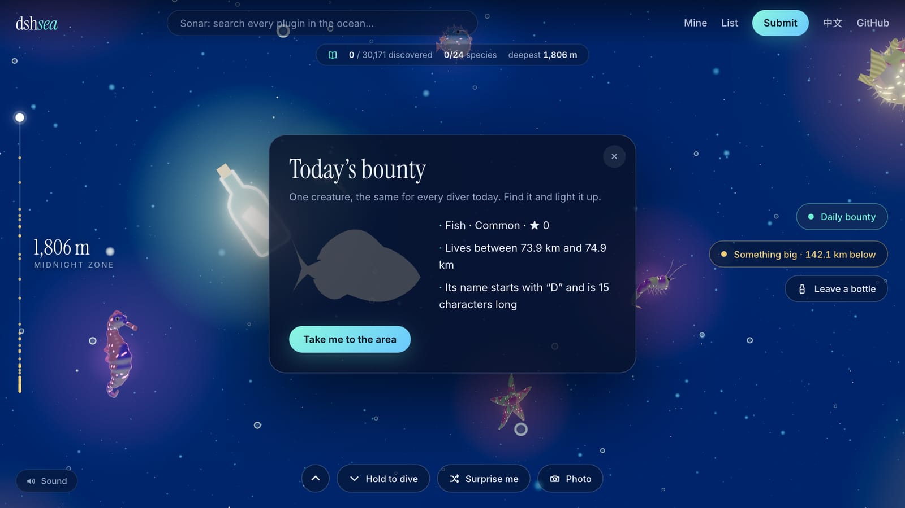
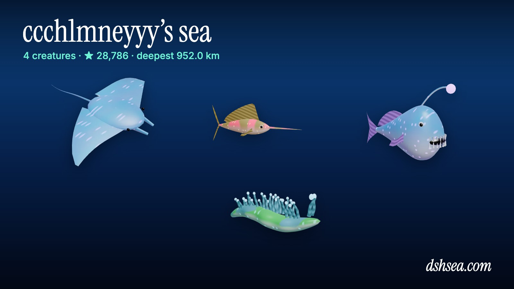
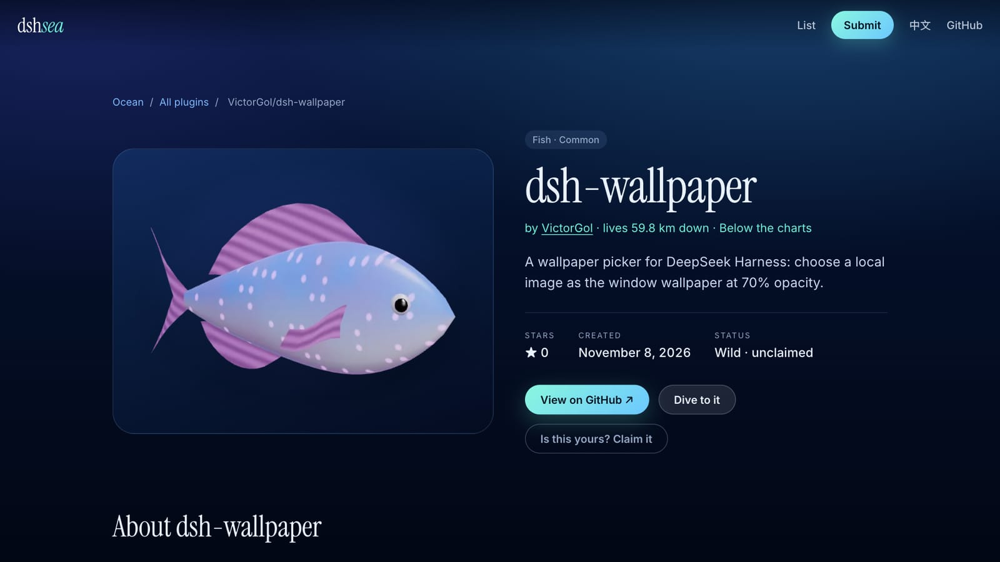

# dshsea

[English](README.md) · [简体中文](README.zh-CN.md) · [日本語](README.ja.md) · **한국어**

**[dshsea.com](https://dshsea.com)** — [DeepSeek Harness](https://github.com/deepseek-ai/deepseek-harness)의 심해.

DeepSeek Harness 플러그인은 모두 끝없는 바다 어딘가에 사는 생물입니다. 3만 마리가 넘고, 24종이며, 똑같이 생긴 것은 하나도 없습니다. 잠수해서 조명으로 비춰 정체를 확인하고, 도감을 채우고, 내 생물을 등록해 보세요.

| | |
| --- | --- |
|  |  |
| **잠수.** 스크롤하거나 밀어 올리거나, 버튼을 누른 채로 몇 킬로미터씩 내려갑니다. 이름은 조명이나 소나가 닿기 전까지 숨겨져 있습니다. | **바닥이 보이지 않습니다.** 가장 새로운 플러그인은 수심 260 m에 있고, 오래될수록 32 m씩 더 깊이 삽니다. 내려갈수록 물빛도 달라집니다. |
|  |  |
| **소나.** 모든 플러그인을 이름으로 검색해 바로 그곳으로 이동합니다. | **만나기.** 각 생물은 자기 저장소로 연결되고, 진화까지 필요한 스타 수를 보여 주며, 작성자가 등록할 수 있습니다. |
|  |  |
| **도감.** 수집할 24종, 업적 15개, 순위표, 그리고 가장 가까운 대형 생물을 가리키는 추적기. | **오늘의 현상수배.** 하루에 한 마리, 모두에게 같은 목표. 단서 세 개와 1 km 구간이 주어집니다. |
|  |  |
| **내 GitHub에는 무엇이 살까?** `dshsea.com/u/<나>`에 내 생물이 모두 모이고, 공유용 카드를 만들 수 있습니다. | **모든 플러그인에 페이지를.** `dsh-plugin` 토픽이 붙은 저장소마다 `dshsea.com/r/owner/repo`가 있고 저장소로 연결됩니다. |

그 밖에 **유리병 편지**(원하는 수심에 다음 다이버를 위한 메모를 남깁니다)와 **사진 모드**(`P` 키)가 있습니다.

## 생물이 모이는 방식

- **야생 생물.** 매주 실행되는 GitHub Action이 `dsh-plugin` 토픽이 붙은 모든 저장소를 `data/wild.json`으로 수집하고, 자동으로 바다에 나타납니다.
- **등록된 생물.** 작성자가 [`data/projects/`](data/projects)에 YAML 파일 하나를 추가해 PR을 보내면 등록됩니다. 전용 페이지, 공유 카드, 배지가 생기고 종도 고를 수 있습니다. 가장 최근에 등록된 8마리는 **웰컴 리프**(모든 다이버가 잠수를 시작하는 수면 바로 아래)에서 헤엄치고, 홈 화면에도 이름이 실립니다. 자세한 내용은 [CONTRIBUTING.md](CONTRIBUTING.md)를 참고하세요.

## 참여하기

등록 방법, 파일 형식, 등재 규칙은 [CONTRIBUTING.md](CONTRIBUTING.md)에 있습니다. 로컬 실행과 배포는 [docs/DEVELOPMENT.md](docs/DEVELOPMENT.md)(영문)를 참고하세요.
