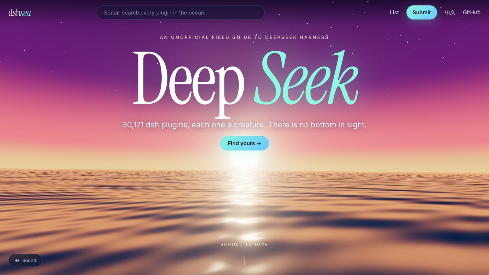
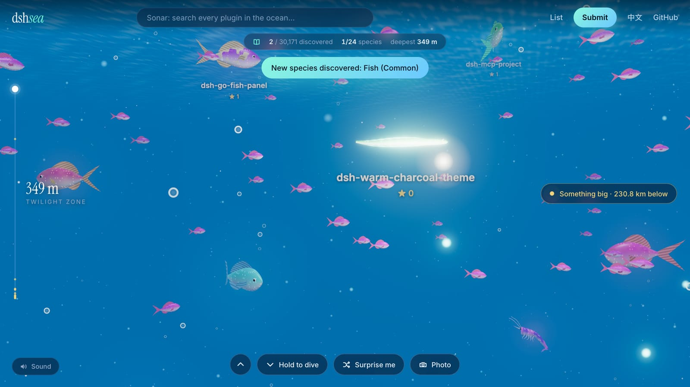
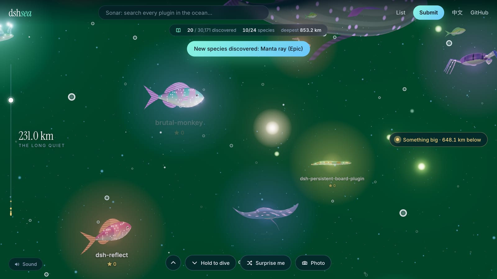
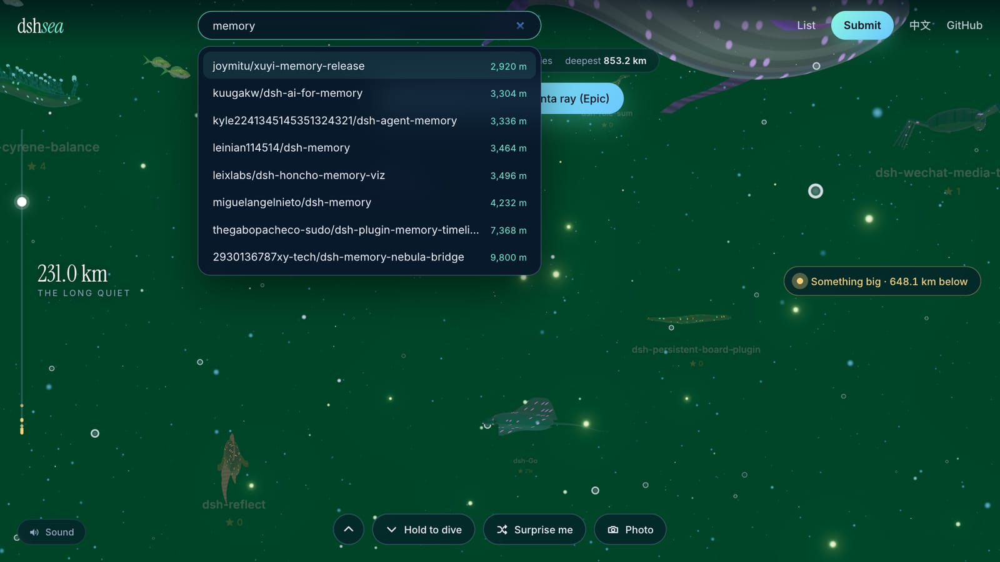
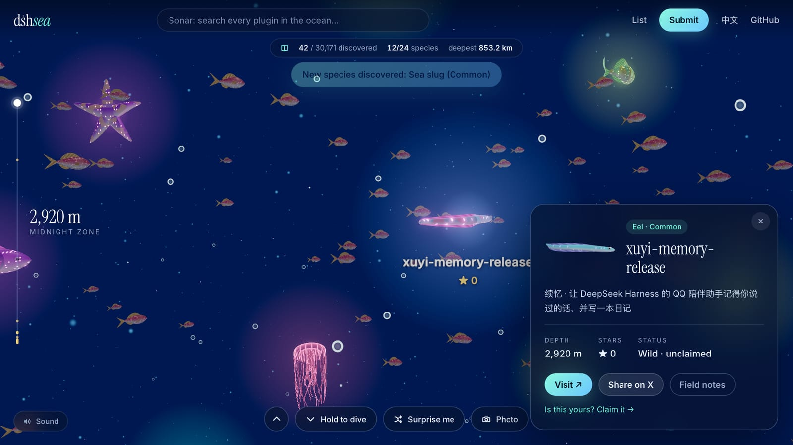
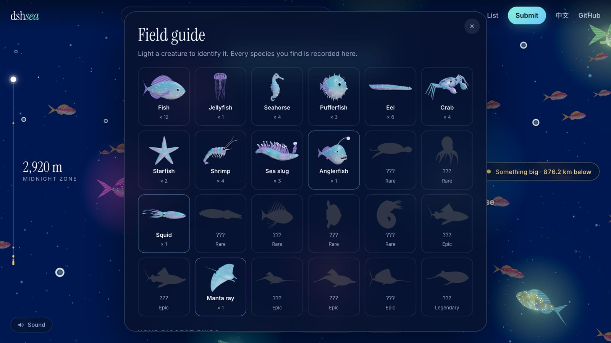
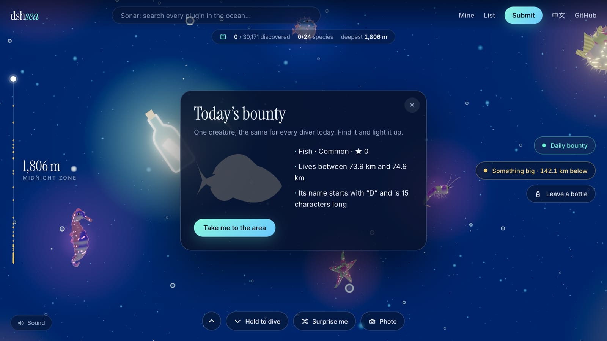
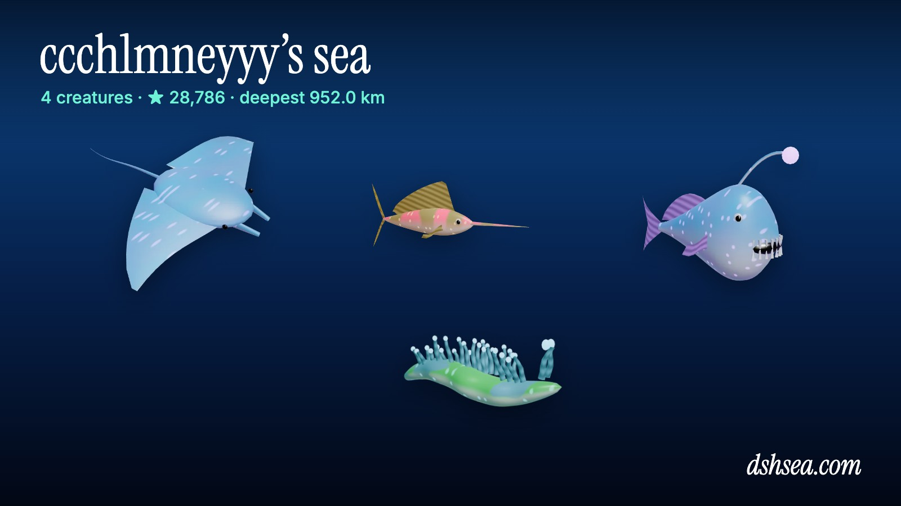
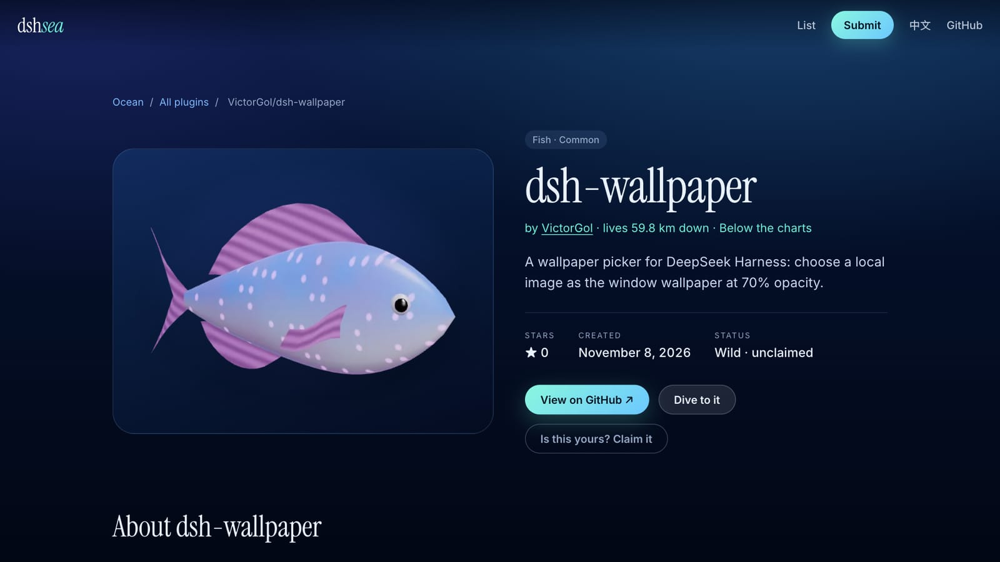

# dshsea

**English** · [简体中文](README.zh-CN.md) · [日本語](README.ja.md) · [한국어](README.ko.md)

**[dshsea.com](https://dshsea.com)** — the deep sea of [DeepSeek Harness](https://github.com/deepseek-ai/deepseek-harness).

Every DeepSeek Harness plugin is a creature somewhere in a bottomless ocean: more than 30,000 of them, 24 species, no two alike. Dive, light them up to identify them, fill your field guide, and claim yours.

[](https://dshsea.com)

| | |
| --- | --- |
| [](https://dshsea.com) | [](https://dshsea.com) |
| **Dive.** Scroll, swipe, or hold the button and fall for kilometres. Names stay hidden until your lamp or a sonar ping identifies a creature. | **No bottom in sight.** The newest plugin swims at 200 m; every older one lives 32 m deeper. The water changes colour as you go. |
| [](https://dshsea.com) | [](https://dshsea.com) |
| **Sonar.** Search every plugin by name and jump straight to it. | **Meet it.** Each creature links to its repo, shows how many stars it needs to evolve, and can be claimed by its author. |
| [](https://dshsea.com) | [](https://dshsea.com) |
| **Field guide.** 24 species to collect, 15 achievements, a leaderboard, and a tracker that points at the nearest giant. | **Daily bounty.** One creature a day, the same for everyone. You get three clues and a 1 km stretch of water. |
| [](https://dshsea.com/u) | [](https://dshsea.com/r/victorgol/dsh-wallpaper) |
| **What lives in your GitHub?** `dshsea.com/u/<you>` gathers all of your creatures and draws a card to share. | **A page for every plugin.** `dshsea.com/r/owner/repo` exists for every repo tagged `dsh-plugin`, with a link back to it. |

Also in the water: **bottles** (leave a note at any depth for the next diver) and a **photo mode** (`P`) that turns what you see into a captioned picture.

## How it fills up

- **Wild creatures.** A weekly GitHub Action crawls every repo tagged `dsh-plugin` into `data/wild.json`. They all appear in the ocean automatically.
- **Claimed creatures.** Authors claim theirs by adding one YAML file under [`data/projects/`](data/projects) in a PR. Claimed creatures get a page, a share card, a badge and a species of their choice. See [CONTRIBUTING.md](CONTRIBUTING.md).

## Development

[Astro](https://astro.build) site with one small Cloudflare Worker. Requires Node 24 (see `.nvmrc`) and pnpm.

```sh
pnpm install
pnpm dev          # http://localhost:4321 (no bottles or leaderboard: those need the Worker)
pnpm build        # validates data, then builds to dist/
npx wrangler d1 execute dshsea --local --file worker/schema.sql   # once, for local bottles and leaderboard
npx wrangler dev  # serves the build with the Worker, exactly as in production
pnpm sync-stars   # refresh stars for claimed projects
GITHUB_TOKEN=... node scripts/sync-wild.mjs   # re-crawl all dsh-plugin repos (about 15 minutes)
```

| Path | What |
| --- | --- |
| `data/projects/*.yaml` | One file per claimed project |
| `data/wild.json` | Every crawled `dsh-plugin` repo: `[repo, stars, created, description]` |
| `data/stars.json` | Stars for claimed projects, refreshed daily by a GitHub Action |
| `scripts/lib/load-projects.mjs` | Loader and validator shared by the site and CI |
| `src/components/ocean3d.ts` | The 3D ocean (three.js): diving, creature streaming, field guide, bounty, bottles, photo mode |
| `src/components/ocean-env.ts` | Its shaders, textures and sound |
| `src/components/creatures3d.ts` | Procedural creature models and their shader |
| `src/components/viewer.ts` | Single-creature 3D viewer on project pages |
| `src/components/ocean.ts` | Lightweight fallback for devices without WebGL2 (or `?2d`) |
| `src/lib/species.ts` | Species, rarity, evolution and zone rules |
| `src/pages/data/` | The ocean as static JSON chunks, the search index, and the lookups for repo and owner pages |
| `src/pages/r/[...repo].astro`, `src/pages/u/[owner].astro` | Landing pages for one repo and one owner. Built once as templates; the Worker fills them in per request, because there are more of them than a static host takes files |
| `src/pages/all/` | Paginated index of every plugin, for crawlers |
| `worker/index.js` | The only server code: renders `/r/*` and `/u/*`, and serves `/api/*` |
| `worker/schema.sql` | D1 tables for bottles and the leaderboard |
| `public/creatures/*.webp` | Still renders of each species. Regenerate with `pnpm render-species` after changing the models (needs `pnpm dev` running and Chrome) |
| `src/pages/og/`, `src/pages/badge/` | Share cards and README badges, generated at build time |

Deployed on Cloudflare Workers: `pnpm build`, then `npx wrangler deploy` (see `wrangler.jsonc`).

### Moderating bottles and the leaderboard

Bottles are limited to 140 characters, no links, five a day per visitor; three reports hide one automatically. Leaderboard scores are self-reported by the browser, so treat the board as a toy. To take something down by hand:

```sh
npx wrangler d1 execute dshsea --remote --command "UPDATE bottles SET hidden = 1 WHERE id = 123"
npx wrangler d1 execute dshsea --remote --command "UPDATE scores SET hidden = 1 WHERE name = 'someone'"
```
