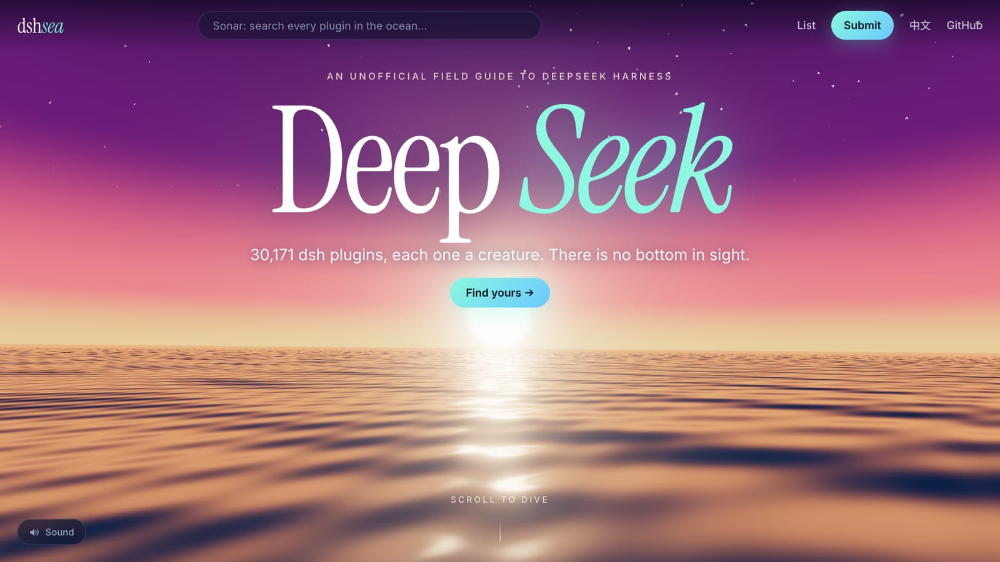
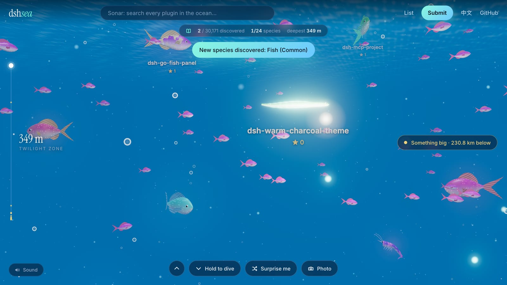
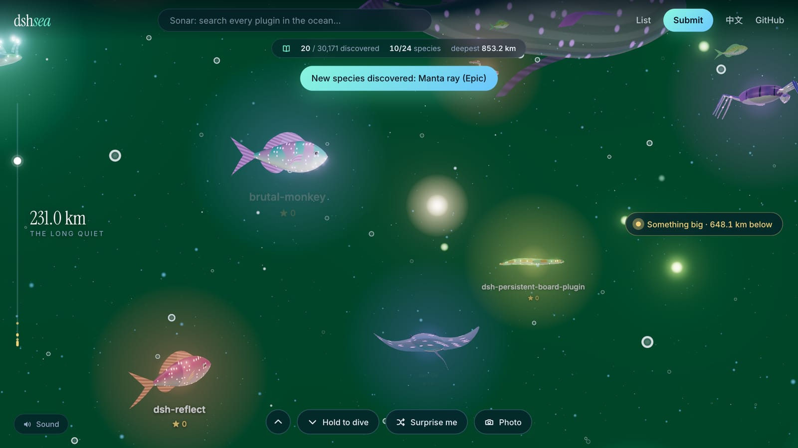
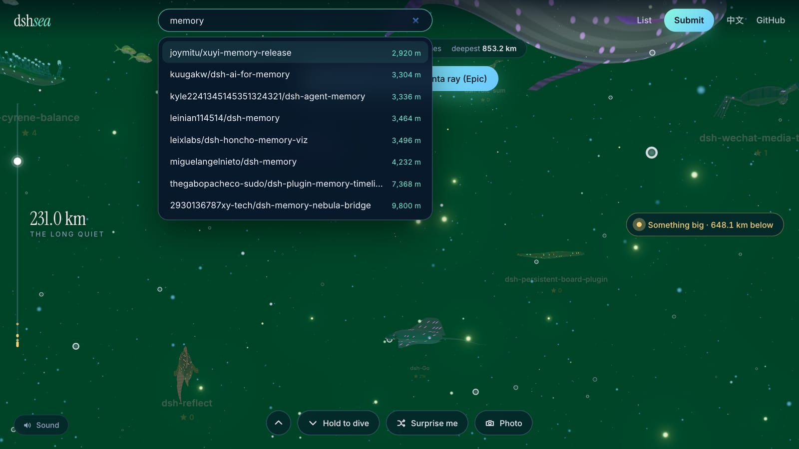
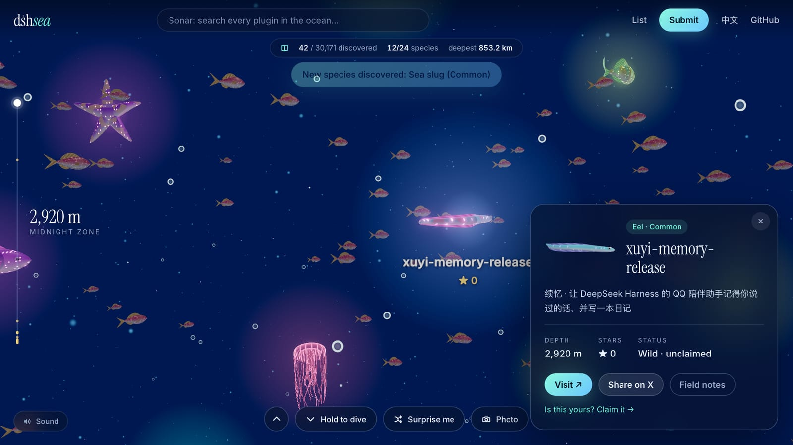
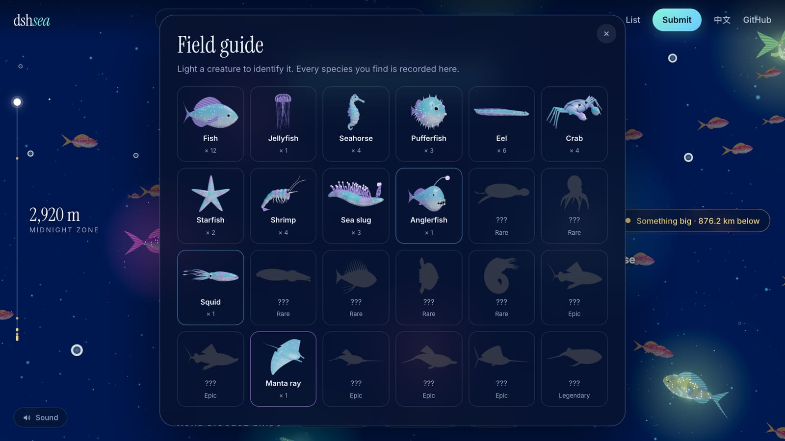
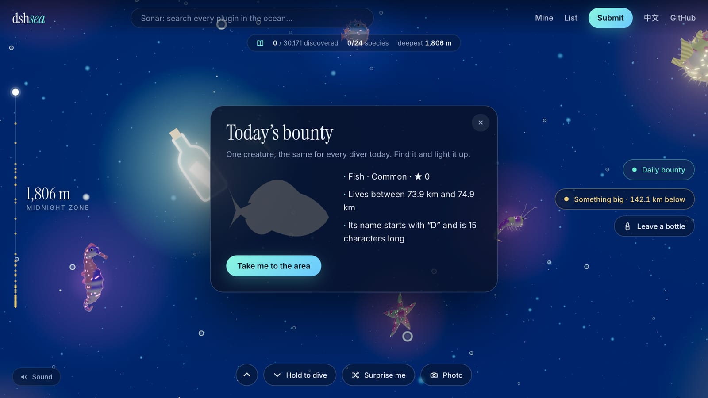
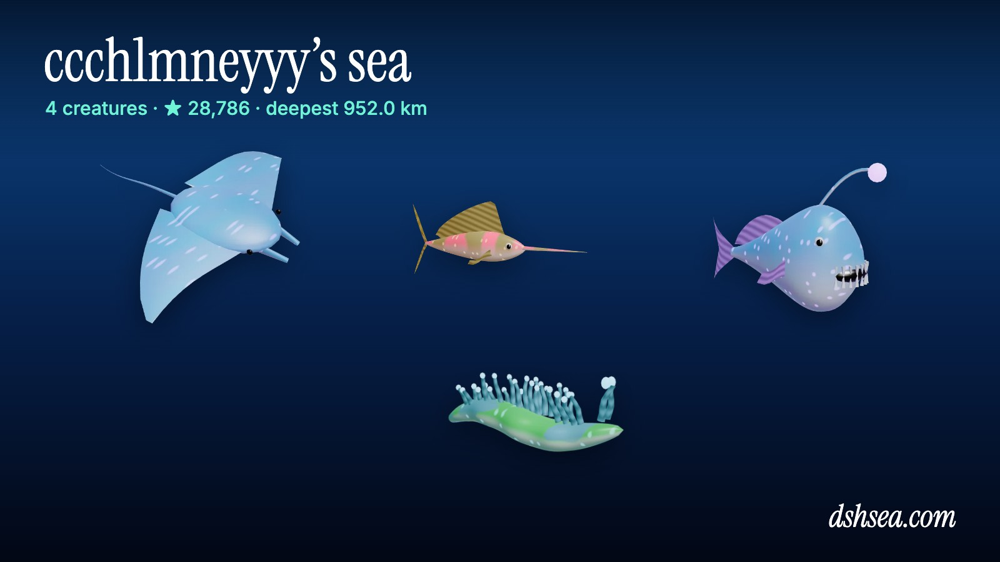
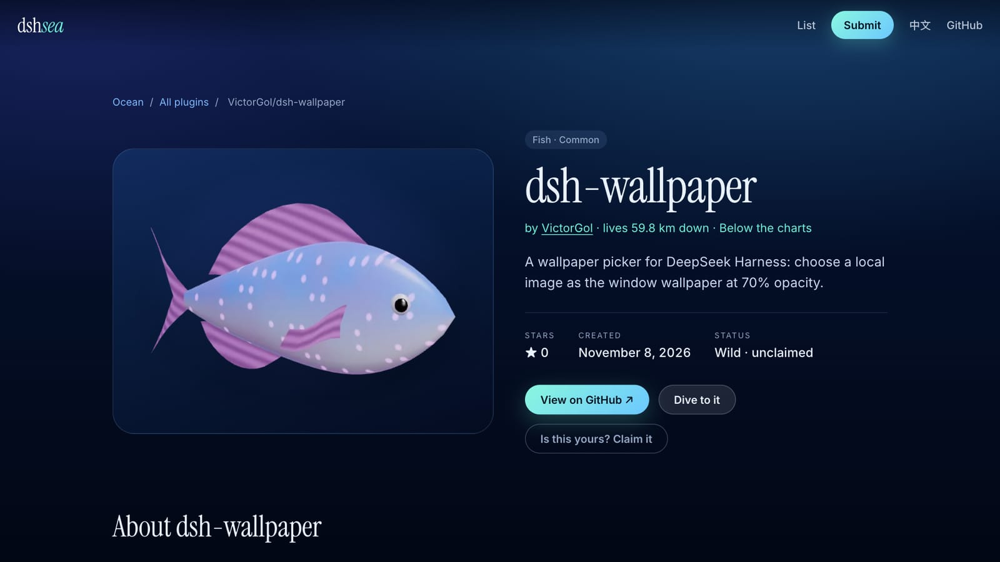

# dshsea

[English](README.md) · **简体中文** · [日本語](README.ja.md) · [한국어](README.ko.md)

**[dshsea.com](https://dshsea.com)** —— [DeepSeek Harness](https://github.com/deepseek-ai/deepseek-harness) 的深海。

每个 DeepSeek Harness 插件都是无底深海里的一只生物：三万多只，24 个物种，没有两只一模一样。下潜，用灯照亮来识别它们，集齐图鉴，然后认领你的那一只。

[](https://dshsea.com)

| | |
| --- | --- |
| [](https://dshsea.com) | [](https://dshsea.com) |
| **下潜。** 滚轮、滑动，或者按住按钮一路坠落几公里。生物的名字默认隐藏，被你的灯或声呐照到才会显示。 | **看不到底。** 最新的插件游在 200 米，每老一个就再深 32 米。越往下，水色也在变。 |
| [](https://dshsea.com) | [](https://dshsea.com) |
| **声呐。** 按名字搜索任何一个插件，直接传送过去。 | **认识它。** 每只生物都链接到自己的仓库，显示还差多少 star 进化，作者可以认领。 |
| [](https://dshsea.com) | [](https://dshsea.com) |
| **图鉴。** 24 个物种、15 个成就、排行榜，以及指向最近巨兽的追踪信号。 | **每日悬赏。** 每天一只，所有人目标相同。给你三条线索和 1 公里的水域。 |
| [](https://dshsea.com/u) | [](https://dshsea.com/r/victorgol/dsh-wallpaper) |
| **你的 GitHub 里住着什么？** `dshsea.com/u/<你>` 汇总你的所有生物，并生成一张可分享的卡片。 | **每个插件都有一页。** 所有带 `dsh-plugin` topic 的仓库都有 `dshsea.com/r/owner/repo`，并链接回仓库。 |

海里还有**漂流瓶**（在任意深度给下一个潜水员留一句话）和**拍照模式**（按 `P`），把眼前的画面变成带说明的图片。

## 生物从哪来

- **野生生物。** 每周一次的 GitHub Action 会把所有带 `dsh-plugin` topic 的仓库抓进 `data/wild.json`，它们会自动出现在海里。
- **已认领的生物。** 作者在 [`data/projects/`](data/projects) 下加一个 YAML 文件并提 PR 即可认领。认领后拥有独立页面、分享卡片、徽章，还能自选物种。详见 [CONTRIBUTING.md](CONTRIBUTING.md)。

## 开发

[Astro](https://astro.build) 站点加一个很小的 Cloudflare Worker。需要 Node 24（见 `.nvmrc`）和 pnpm。

```sh
pnpm install
pnpm dev          # http://localhost:4321（没有漂流瓶和排行榜，它们需要 Worker）
pnpm build        # 先校验数据，再构建到 dist/
npx wrangler d1 execute dshsea --local --file worker/schema.sql   # 只需一次，用于本地的漂流瓶和排行榜
npx wrangler dev  # 带 Worker 运行构建产物，与线上一致
pnpm sync-stars   # 刷新已认领项目的 star
GITHUB_TOKEN=... node scripts/sync-wild.mjs   # 重新抓取所有 dsh-plugin 仓库（约 15 分钟）
```

目录结构说明见[英文 README](README.md#development)。部署在 Cloudflare Workers 上：`pnpm build` 之后执行 `npx wrangler deploy`。

### 管理漂流瓶和排行榜

漂流瓶限 140 字、不能带链接、每位访客每天 5 个；被举报 3 次会自动隐藏。排行榜分数由浏览器自行上报，只当作娱乐。手动下架：

```sh
npx wrangler d1 execute dshsea --remote --command "UPDATE bottles SET hidden = 1 WHERE id = 123"
npx wrangler d1 execute dshsea --remote --command "UPDATE scores SET hidden = 1 WHERE name = 'someone'"
```
